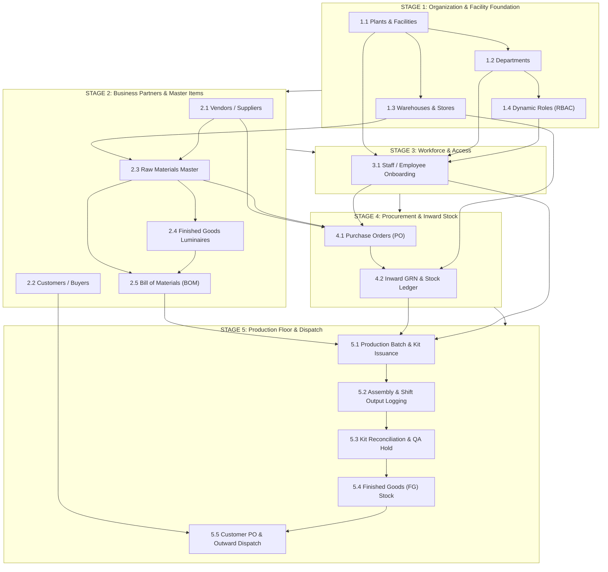

# 📋 MIPS Master Data Setup & Data Entry Dependency Guide
**System:** Manufacturing Inventory & Production System (MIPS)  
**Company:** Eiffel LED Lighting Pvt. Ltd.  
**Purpose:** Step-by-Step Data Onboarding Guide & Relational Dependency Matrix  
**Audience:** System Administrator / Operations Data Entry Operator

---

## 📌 Executive Summary

In a manufacturing ERP like MIPS, **data cannot be entered randomly**. Certain master records must exist first because later records directly depend on them via relational dropdowns (e.g. you cannot create a Raw Material without a Supplier and Warehouse; you cannot create a BOM without Raw Materials; you cannot onboard an Employee without Plants and Departments).

Follow this step-by-step checklist sequentially to ensure zero missing references and 100% data integrity.

---

## 🗺️ Master Dependency Flowchart

---

## 🪜 Step-by-Step Data Entry Sequence

---

### 🟢 STAGE 1: Organizational Foundation (Settings Module)
> **Location:** Navigation Sidebar → **Settings** (`/settings`)

Must be set up first before entering staff, stock, or items.

#### Step 1.1: Plants & Manufacturing Facilities
* **Why first?** All departments, warehouses, inventory ledgers, and staff belong to a plant facility.
* **Fields to Enter:**
  - Facility Name (e.g. `Plant 1 - Pune Hub`, `Plant 2 - Chakan Cluster`)
  - Facility Code (e.g. `PLANT-PUN-01`)
  - Location / City & State (e.g. `Pune, Maharashtra`)
  - Facility Type (`Mother Manufacturing Unit`, `Assembly Unit`, `Central Warehouse`)
  - Plant Head / General Manager

#### Step 1.2: Departments
* **Prerequisite:** Plant Location from Step 1.1 must exist.
* **Fields to Enter:**
  - Department Name (e.g. `Raw Material Stores`, `Final Assembly Line 1`, `SMT Surface Mount`, `Quality Assurance`)
  - Linked Plant (Dropdown selector linking to Step 1.1)
  - Department Head / Manager
  - Active Work Teams / Sub-cells (e.g. `Line 1 Alpha`, `Shift B Potting Cell`)

#### Step 1.3: Warehouses & Physical Stores
* **Prerequisite:** Plant Location from Step 1.1 must exist.
* **Location:** Navigation Sidebar → **Masters** → **Warehouses** tab
* **Fields to Enter:**
  - Warehouse Name (e.g. `Main Raw Material Store`, `Assembly Line 1 Buffer`, `Finished Goods Depot`)
  - Facility Location (Select Plant from Step 1.1)
  - Storage Type (`Raw Material Warehouse`, `Shop Floor Buffer`, `Finished Goods Rack`)
  - Capacity & Units (e.g. `15,000 Bins / Pallets`)
  - Assigned Store Manager

#### Step 1.4: Dynamic Roles & Access Control
* **Location:** Navigation Sidebar → **Settings** → **Roles & Permissions** tab
* **Note:** Standard system roles (`Super Admin`, `Plant Manager`, `Store Manager`, `Purchase Manager`, `Production Manager`, `Floor Supervisor`, `Worker`) are pre-configured. Add custom roles only if needed.

---

### 🟡 STAGE 2: Commercial Partners & Engineering Masters
> **Location:** Navigation Sidebar → **Masters** (`/masters`)

#### Step 2.1: Suppliers & Vendors
* **Why now?** Raw materials require a primary designated supplier.
* **Fields to Enter:**
  - Vendor / Supplier Name (e.g. `Bridgelux Semiconductor`, `Nichia LED Corp`, `Delta Electronics`)
  - Category (`Semiconductor & LEDs`, `Drivers & Power`, `Optics & Lenses`, `Aluminium Extrusions`)
  - Contact Person, Official Phone Number & Email
  - Factory City & State
  - Average Delivery Lead Time (e.g. `7 Days`, `21 Days`)
  - Payment Terms (`Net 30 Days`, `100% Advance`, `50% Advance - Balance on Dispatch`)

#### Step 2.2: Customers & Registered Institutional Buyers
* **Why now?** Customer orders and dispatch challans need buyer details.
* **Fields to Enter:**
  - Company / Buyer Name (e.g. `Tata Projects Ltd`, `L&T Construction`, `Bajaj Electricals`)
  - Buyer Category (`Infrastructure Contractor`, `OEM Brand`, `Government EPC`, `Commercial Distributor`)
  - GSTIN (15-character Tax ID)
  - Billing / Shipping City & State
  - Commercial Payment Terms (`Net 45 Days`, `LC 60 Days`)
  - Contact Person, Phone & Email

#### Step 2.3: Raw Materials & Components Master
* **Prerequisites:** Primary Supplier (Step 2.1) and Default Warehouse (Step 1.3) must exist.
* **Fields to Enter:**
  - Item Code (e.g. `LED-SMD-3030`, `DRV-50W-CC`, `HSG-ALU-60W`)
  - Material Name & Technical Specification (e.g. `Bridgelux SMD 3030 5000K LED Chip`)
  - Component Category (`LED Emitters`, `LED Drivers`, `Housing & Heat Sinks`, `Optics / Diffusers`, `Packaging`)
  - Unit of Measurement — UOM (`PCS`, `MTRS`, `KGS`, `ROLLS`)
  - Standard Purchase Unit Cost in ₹ (e.g. `₹ 1.85 / unit`)
  - Primary Supplier (Dropdown linking to Step 2.1)
  - Storage Warehouse (Dropdown linking to Step 1.3)
  - Minimum Safety Stock & Reorder Trigger Level

#### Step 2.4: Finished Goods (Luminaires) Catalog
* **Fields to Enter:**
  - Luminaire Model Code (e.g. `LUM-SL-50W-IP66`, `LUM-HB-100W-6500K`)
  - Product Name (e.g. `50W IP66 Nova Street Light Luminaire`)
  - Category (`Street Lighting`, `High Bay Industrial`, `Flood Lighting`, `Cleanroom Batten`)
  - System Wattage (`30W`, `50W`, `100W`, `150W`)
  - Standard Manufacturing Cost in ₹

#### Step 2.5: Interactive Bill of Materials (BOM)
* **Prerequisites:** Finished Good (Step 2.4) and Raw Materials (Step 2.3) must exist.
* **Why critical?** Defines the exact recipe for production kits.
* **Data to Configure:**
  - Select the Finished Luminaire.
  - Add each child component from Raw Materials.
  - Set the **Quantity Per Unit** (e.g. 1 Street Light = 50 LEDs + 1 Driver + 1 Housing + 1 Lens Diffuser + 1 Cable Gland + 1 Packaging Box).
  - The system automatically calculates total standard material cost per unit.

---

### 🔵 STAGE 3: Workforce Onboarding (Workforce Module)
> **Location:** Navigation Sidebar → **Workforce** (`/employees`)

#### Step 3.1: Staff & Operator Onboarding
* **Prerequisites:** Plant (1.1), Department (1.2), Role (1.4), and Supervisors must exist.
* **Fields to Enter in Onboarding Wizard:**
  1. Full Legal Name
  2. Employee Code (e.g. `EMP-1010`)
  3. Official Email & Mobile Phone Number
  4. Initial Login PIN (6-digit numeric, defaults to `123456`)
  5. Plant Location (UBAC Scope dropdown)
  6. Department (Filtered dynamically by plant)
  7. Designated Role (SuperAdmin, Plant Manager, Store Manager, Purchase Manager, Supervisor, Worker)
  8. Assigned Sub-team / Shift Cell (e.g. `Line 1 Alpha`)
  9. Reporting Supervisor (Select from Department Managers)
  10. Workstation / Assembly Bench (e.g. `Station 2 - Housing & Cap Press`)
  11. Skills & Station Certifications (e.g. `SMD Soldering, Hi-Pot Testing`)

---

### 🟣 STAGE 4: Procurement & Physical Inwarding (Procurement Module)
> **Location:** Navigation Sidebar → **Procurement** (`/procurement`)

#### Step 4.1: Purchase Orders (PO) to Vendors
* **Prerequisites:** Vendors (2.1), Raw Materials (2.3), and Purchasing Staff (3.1).
* **Fields to Enter:**
  - PO Reference Number (e.g. `PO-2026-089`)
  - Select Supplier / Vendor
  - Destination Receiving Plant & Warehouse
  - Ordered Items & Quantities
  - Agreed Unit Price & Delivery ETA Date
  - Commercial Terms & Transporter Tracking

#### Step 4.2: Inward Goods Receipt Note (GRN) & QA Inspection
* **Prerequisites:** Approved PO from Step 4.1.
* **Actions:**
  - Match physical delivery challan with PO.
  - Enter Received Quantity vs Damaged / Rejected Quantity.
  - Complete Quality Verification (CCT Binning, Surge Testing, Visual Inspection).
  - Click **Confirm GRN Receipt** → Inventory ledger updates automatically.

---

### 🟠 STAGE 5: Production Floor & Dispatch
> **Location:** **Kits** (`/kits`), **Production** (`/production`), **Dispatch & POs** (`/orders-dispatch`)

#### Step 5.1: Production Batches & BOM Kit Issuance
* **Prerequisites:** Finished Product BOM (2.5), Available Stock in Store (4.2), and Assembly Supervisor (3.1).
* **Actions:**
  - Select Finished Luminaire & Target Batch Quantity (e.g. 500 units).
  - System generates Kit picking list using the exact BOM.
  - Store Manager issues materials to Supervisor / Worker cell.

#### Step 5.2: Shift Output Logging & Assembly Progress
* **Actions:**
  - Assembly workers log hourly completed units, runtime efficiency, and station scrap.
  - Supervisor reviews yield vs standard expected time per unit.

#### Step 5.3: Kit Reconciliation & QA Hold
* **Actions:**
  - Supervisor reconciles: `Issued Components = Units Assembled + Unused Returns + Scrap/Damage`.
  - Rejection scrap is logged with reason (e.g. SMD diode thermal damage, optic scratch).
  - Kit status marked as **Closed**.

#### Step 5.4: Finished Goods Entry
* Passed units are moved into Finished Goods inventory with batch lot number.

#### Step 5.5: Customer Orders & Outward Dispatch
* **Prerequisites:** Customer Master (2.2) and Finished Goods in Stock (5.4).
* **Actions:**
  - Enter Customer PO details & delivery deadline.
  - Allocate Finished Goods stock.
  - Generate Outward Delivery Challan & Dispatch Gate Pass.

---

## ⚠️ Common Pitfalls & What to Avoid

| ❌ Common Error | Why It Fails | ✅ Correct Procedure |
|-----------------|--------------|----------------------|
| Adding Raw Material before creating Suppliers | Primary supplier dropdown will be empty | Add at least 1 Supplier under Masters → Suppliers first |
| Adding Raw Material before creating Warehouses | Storage warehouse dropdown will be empty | Set up Warehouses under Masters → Warehouses first |
| Adding Employee before creating Department | Department selector will have no options | Create Plants & Departments in Settings first |
| Building BOM before adding Raw Materials | No components available to assign to product | Enter all individual Raw Materials before opening BOM |
| Creating Production Kit when Stock is Zero | System blocks kit issuance if inventory is insufficient | Inward material via PO → GRN first |
| Employee cannot log in | Employee entered without valid 6-digit PIN | Ensure 6-digit PIN is set (e.g. `123456`) in Onboarding Wizard |

---

## 📋 Quick Setup Checklist (Printable)

- [ ] **1. Facilities:** Enter Pune Hub & Chakan facilities in Settings.
- [ ] **2. Departments:** Enter Assembly, Stores, SMT, QA departments mapped to facilities.
- [ ] **3. Warehouses:** Enter Raw Material Store, Buffer Stores, FG Racks.
- [ ] **4. Vendors:** Add key suppliers (LED chips, Drivers, Aluminium housings).
- [ ] **5. Customers:** Add key clients & institutional buyers with GST numbers.
- [ ] **6. Raw Materials:** Add full bill of raw items with UOM & unit standard costs.
- [ ] **7. Products:** Add Finished Luminaire models (Street Light, High Bay, Flood Light).
- [ ] **8. BOMs:** Link Raw Materials & consumption counts to each Luminaire model.
- [ ] **9. Staff Directory:** Onboard plant manager, store manager, supervisors, workers with default PIN `123456`.
- [ ] **10. Initial Inward:** Record opening stock or initial PO + GRN in Procurement.
- [ ] **11. Ready for Production!** Issue kits and dispatch orders.

